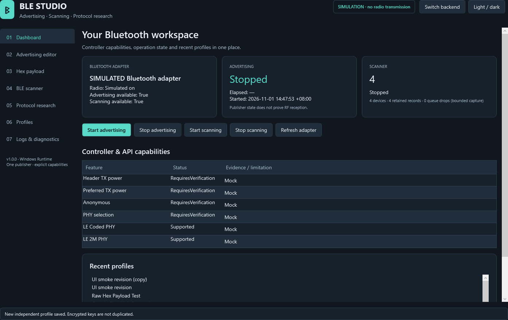
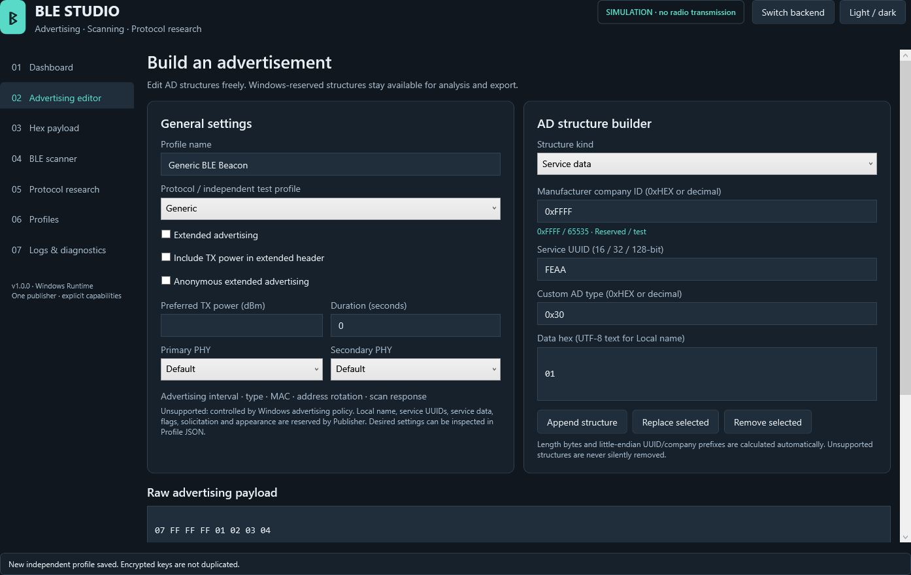
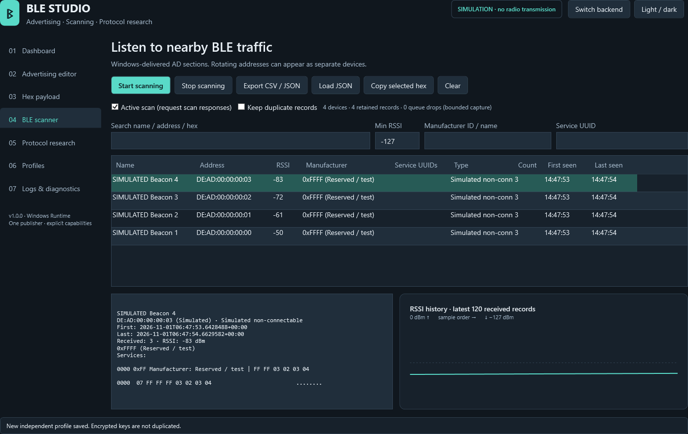
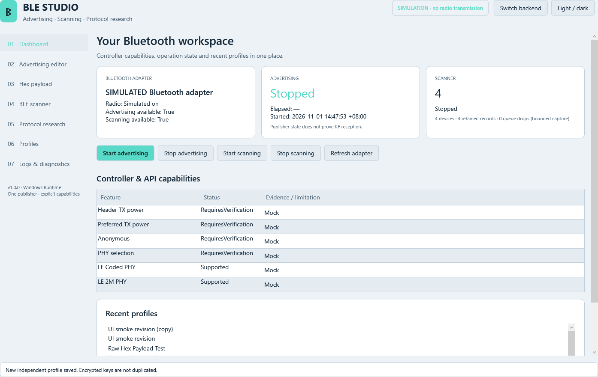

# Windows BLE Advertising Studio

[繁體中文](README.md) · **English**

A Windows 10/11 desktop workbench for editing BLE advertising data, operating
the Windows BLE publisher and watcher, and inspecting location-network packet
formats. Built with C# / .NET 10 LTS, WPF and MVVM. MIT licensed.

## Download

**[Download Windows builds from GitHub Releases](https://github.com/root50643/Windows-BLE-Advertising-Studio/releases)**

Download `Windows-BLE-Advertising-Studio-v1.0.0-win-x64.zip`, extract the complete
ZIP and open `Windows-BLE-Advertising-Studio-win-x64/BLEStudio.exe`. No Visual
Studio or separately installed .NET runtime is required. Releases also provide
the standalone `BLEStudio.exe`, `SHA256SUMS.txt` and `build-info.json`. The ZIP
includes both READMEs, technical documentation, screenshots, profiles and runtime
notices. Binaries are currently unsigned. See [release instructions](docs/releasing.md).

Verify downloaded assets against the matching release's checksum file:

```powershell
Get-FileHash .\BLEStudio.exe -Algorithm SHA256
Get-FileHash .\Windows-BLE-Advertising-Studio-v1.0.0-win-x64.zip -Algorithm SHA256
```

## Project Overview

The application separates user input, bytes submitted to the backend,
Publisher `Started` confirmation, and user-imported external observations.
Windows acceptance is never presented as proof of an identical radio packet,
Apple/Google enrollment, or a received location report.

## Screenshots

Actual WPF application renders from the automated GUI run, with the clearly
marked simulation backend. These are executable application captures, not
design mockups; the native window frame is excluded.






## Features

- Seven English GUI pages, dark/light themes, no console window.
- Actual adapter/radio detection, PnP/driver metadata when readable, explicit
  Supported / Unsupported / Unknown / RequiresVerification capability states.
- Windows advertising Start/Stop with asynchronous status and error reporting;
  manufacturer/custom non-reserved AD data, extended advertising, optional
  header TX power, requested TX power, anonymity and runtime-guarded PHY options.
- An AD structure builder for manufacturer data, 16/32/128-bit service data and
  UUIDs, solicitation, flags, appearance, UTF-8 local names and custom AD types.
  Reserved Windows types remain editable and exportable, and are blocked on Start.
- Editable hex, offset/hex/ASCII view, AD decoding and length validation.
- Live BLE scanner, filters, per-address aggregates, details and RSSI chart.
- Versioned JSON profiles, revisions, import/export, duplication and rename.
- Independent Apple/Google protocol analysis and compatibility reports.
- Per-user Windows DPAPI key storage, bounded capture queues and diagnostic logs.
- Mock backend, xUnit tests, published-app GUI smoke checks and Windows CI/CD.

## System Requirements

- Windows 10 version 2004 (build 19041) or later, or Windows 11; x64.
- A functioning BLE adapter and Windows driver for radio operations. Peripheral
  role is checked for advertising. LE scanning and the radio must be available.
- Extended advertising and PHY features depend on the actual OS/API/driver and
  controller. A model name alone does not determine support.
- Editing, research, profile management and mock mode work without Bluetooth.

## Quick Start

1. Open `BLEStudio.exe`. Start on **Dashboard** and inspect the adapter state.
2. Select **Generic BLE Beacon** from Profiles. This contains reserved/test
   company ID `0xFFFF` and a small local test payload, without a location identity.
3. In **Advertising editor**, change supported payload bytes and check validation.
4. Click **Start advertising** and wait for **Started**; click **Stop advertising**
   to stop. Windows can return Waiting or Aborted with a reason.
5. Open **BLE scanner**, click **Start scanning**, select a device and inspect
   its AD sections and RSSI history. Stop scanning when finished.

**Switch backend** stops active operations and changes to/from the explicitly
labelled simulator. Mock success never represents a radio transmission.

## BLE Advertising

The Windows backend uses `BluetoothLEAdvertisementPublisher`. All AD lengths,
company prefixes and UUID byte order are calculated by the builder. Raw input
remains authoritative; unsupported fields are not silently stripped.

Windows reserves a substantial set of AD types, including local name, flags,
TX-power AD data, service UUID lists, service data, solicitation and appearance.
Manufacturer data is allowed; custom non-reserved data is subject to runtime
acceptance. The standard Windows publisher does not expose interval, connection
or scan flags, MAC selection, address rotation or a scan-response editor.
See the [capability matrix](docs/windows-capabilities.md) and
[Microsoft's Publisher reference](https://learn.microsoft.com/en-us/uwp/api/windows.devices.bluetooth.advertisement.bluetoothleadvertisementpublisher).

Legacy input has a conservative 28-byte budget, including AD length/type
headers, reserving 3 of the 31 legacy bytes for Windows flags. Extended input
uses the adapter-reported maximum; Windows may still reject a combination.
Duration is an application Stop timer, not a controller interval guarantee.

## BLE Scanner

`BluetoothLEAdvertisementWatcher` delivers AD sections, names, address type,
RSSI and timestamps. Search name/address/hex, set a minimum RSSI, and filter
company ID/name or service UUID. Active/passive mode is selected before Start.

Counters update for every received record. When duplicate retention is off,
only changed payload records enter capture history; the latest device summary
still updates. Limits: 5,000 devices, 20,000 retained records, 5,000 queued
packets, 120 RSSI samples per device, 2,000 log entries. Queue drops are shown.
Addresses can rotate; an address is not a stable device identity.

Export JSON for later loading, or CSV for current summaries. Loaded counters
represent retained records and cannot reconstruct duplicates previously dropped.
CSV protects names from spreadsheet formula execution. Scan data contains
potentially identifying information; export only authorized captures.

## Payload Editor

Hex accepts contiguous pairs, spaces, newlines, `0x` prefixes, commas, colons and
hyphens. Invalid digits, odd nibbles, truncated AD structures and nonzero data
after a zero terminator are rejected. Import `.bin`, plain hex `.hex` or `.txt`;
export `.bin` or `.hex`. Intel HEX address/checksum records are not supported.

The Hex page shows input, backend submission, Started confirmation and external
observation as distinct records. Import [external observation JSON](docs/external-observation.example.json)
from an independently controlled scanner for a byte comparison. Capture provenance
is supplied by the user, not authenticated by the application.

## Apple Find My Research

The analyzer recognizes the OpenHaystack `0x004C / 0x12 / 0x19` offline-finding
manufacturer format and exposes state, public-key suffix, high bits and hint.
Import an authorized 28-byte test public key to preview its AD structure and
required static-random address. Length validation does not certify a valid
curve point or ownership. Broader AirTag frame variants are not certified.

Windows cannot set the required key-derived BLE address. The reference
31-byte payload also exceeds this backend's legacy budget. Therefore this
project **does not implement a functioning Apple Find My accessory or location
report pipeline**. It does not log into Apple or retrieve reports. Reference:
[OpenHaystack](https://github.com/seemoo-lab/openhaystack).

## Google Find Hub Research

The FHN v1.3 analyzer recognizes `0xFEAA` service data, frame type `0x40`/`0x41`,
20/32-byte EIDs and hashed flags (required in unwanted-tracking-protection mode,
optional only under the specification's normal-mode conditions). Preview an authorized, precomputed
EID; import a 32-byte secret EIK separately to the encrypted vault if required
for your research records. EIK-to-EID derivation, cryptographic authentication,
Fast Pair GATT, DULT, account login, enrollment and report retrieval are not
implemented. The preview is a format fixture, not a provisioned accessory.

Windows reserves the required flags/service data and cannot synchronize
address rotation. Unregistered advertisements are not assumed to appear in
the official Find Hub app. References:
[Google FHN specification](https://developers.google.com/nearby/fast-pair/specifications/extensions/fmdn),
[GoogleFindMyTools](https://github.com/leonboe1/GoogleFindMyTools).

Apple and Google profiles and vault references are independent. Stop the single
publisher before switching profiles. Simultaneous dual advertising is not claimed.

## Profiles

Six embedded templates seed `%LOCALAPPDATA%/BLEStudio/profiles` on first launch.
New, save, rename, save-as/duplicate, delete, import and export are GUI actions.
Save snapshots the previous revision; select and load a revision, then Save to
create a new revision. Selecting another profile replaces the unsaved draft.
The JSON pane can inspect/edit all desired parameters, including unsupported
requests that will fail validation on Start. Unknown schema versions, fields
and enum values are rejected instead of silently discarded.

Exports omit key references; imports receive a new ID and cannot import local
vault access. Duplication creates a separate profile without copying keys.
Deleting a profile preserves its revision directory and separately managed keys;
delete the profile key before deleting the profile when erasure is required.

## Building from Source

Install the [.NET 10 SDK](https://dotnet.microsoft.com/download/dotnet/10.0).
The Windows SDK projection is restored from NuGet; no paid libraries are needed.

```powershell
.\scripts\build.ps1
```

The script restores, builds, tests, publishes, packages the complete output,
and writes EXE byte size, version and SHA256 to `build-info.json` and
`SHA256SUMS.txt`. It also recognizes a user-local `%USERPROFILE%/.dotnet` SDK.
If the previous EXE is running, pass `-OutputDirectory artifacts\release-next`
to publish a separate copy. Output directories must remain beneath this
workspace's `artifacts` folder.

Direct publish:

```powershell
dotnet publish .\src\BLEStudio.App\BLEStudio.App.csproj -c Release -r win-x64 --self-contained true -p:PublishSingleFile=true -p:PublishTrimmed=false
```

```powershell
dotnet test .\BLEStudio.sln -c Release
.\scripts\test-ui.ps1
.\scripts\test-hardware.ps1   # opt-in: transmits a generic test beacon briefly
```

The EXE is a self-contained single-file WinExe. Native runtime files can
self-extract to the Windows user temp cache; do not strip additional files
from a published distribution. Read [architecture](docs/architecture.md),
[testing](docs/testing.md) and [contributing](CONTRIBUTING.md).

## GitHub Releases

Windows GitHub Actions build and test every branch push / pull request and
upload the published ZIP. A `vX.Y.Z` tag runs the full pipeline and published
GUI smoke checks, then uses the repository-scoped GitHub token to create a
Release with standalone EXE, ZIP, checksums, build information and release notes.
No Bluetooth hardware is required in CI. Source is hosted at
[root50643/Windows-BLE-Advertising-Studio](https://github.com/root50643/Windows-BLE-Advertising-Studio);
actual workflow results are available in [Actions](https://github.com/root50643/Windows-BLE-Advertising-Studio/actions).

## Known Limitations

- Windows owns RF scheduling, addresses, many AD types and scan responses.
- PHY selectors are enabled only when the runtime API and SDK projection are
  present; controller flags gate LE 2M / Coded choices. Preferred power is a request.
- A local watcher cannot independently validate its own publisher's RF packet.
- Company-name lookup is a small known subset; unknown IDs stay numeric.
- No HCI raw-packet injection, GATT server, remote accounts, provisioning,
  Apple/Google reports, EID generation or DULT accessory implementation.
- No automatic EID/key/address rotation. No simultaneous dual-protocol guarantee.
- Screenshots use mock data. Real hardware results are documented separately.
- EXE code signing is not configured; release binaries are unsigned.

## Troubleshooting

- **No adapter / radio off:** enable Bluetooth in Windows Settings, check Device
  Manager and click Refresh adapter. Editing and mock mode remain available.
- **Waiting / Aborted:** stop, inspect the error code, close competing Bluetooth
  applications and verify the driver. `DataTooLarge` can depend on Windows policy.
- **Validation failure:** check reserved AD types and payload length. Changing
  a type to bypass a reservation does not preserve protocol compatibility.
- **No scan records:** allow time for Windows to transition from Created to
  Started, check RSSI/search filters, verify nearby BLE traffic and permissions.
- **Permission / policy errors:** use the normal Windows Bluetooth/privacy and
  organization policy controls; the application does not bypass them.
- **Startup or packaging issues:** use the full ZIP, ensure user temp is writable,
  and export Logs & Diagnostics. Diagnostic reports include local adapter IDs;
  review them before sharing publicly.

## Security & Privacy

Use owned equipment and informed participants. Research actions require the
in-app consent acknowledgement; research transmissions have a 1–300 second
limit. Keys are encrypted using CurrentUser DPAPI, are separate from profiles,
and are excluded from default logs and exports. DPAPI does not protect against
other code running as the same Windows user. Original imported key files remain
the user's responsibility. Public keys/EIDs and scan exports can still identify
tests; do not publish them casually. See [security policy](SECURITY.md).

## License

[MIT](LICENSE). See [third-party notices](THIRD-PARTY-NOTICES.md). This project
has no affiliation with Apple, Google, Microsoft or Bluetooth SIG.
