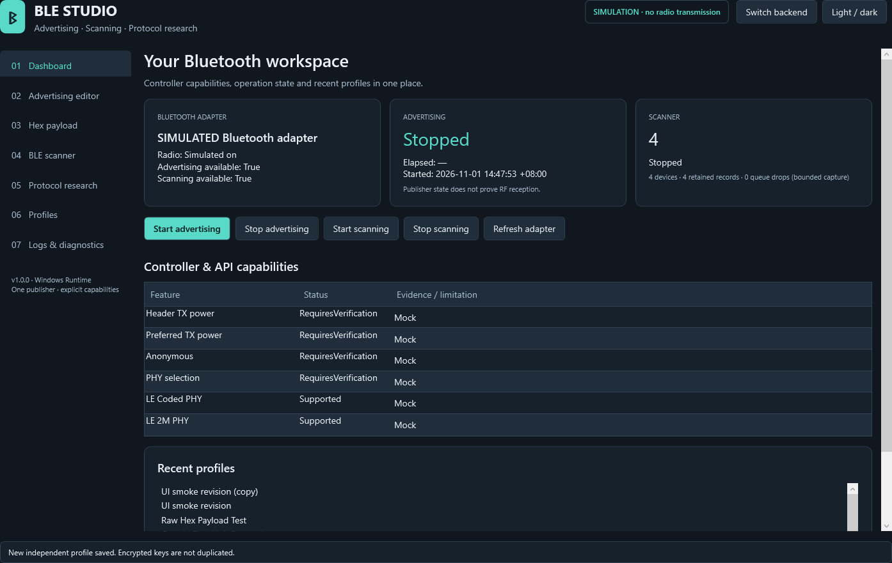
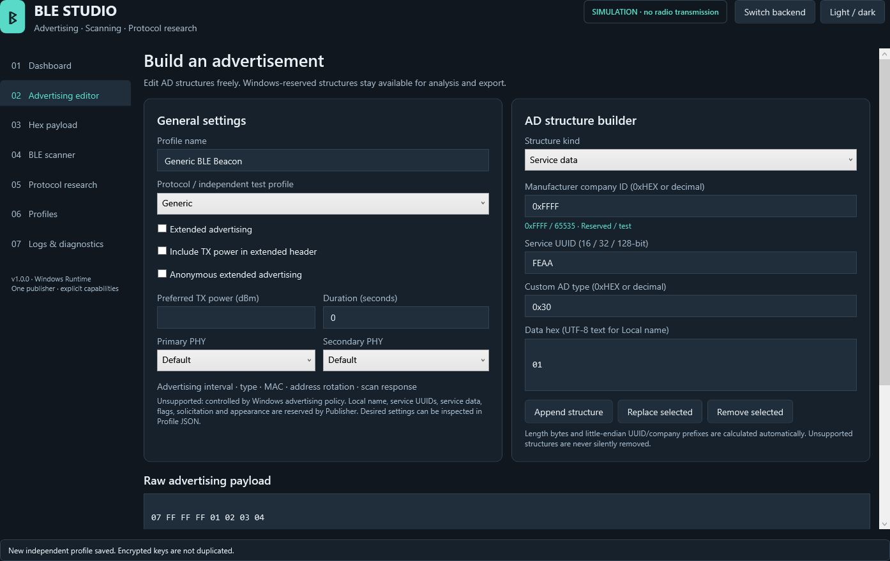
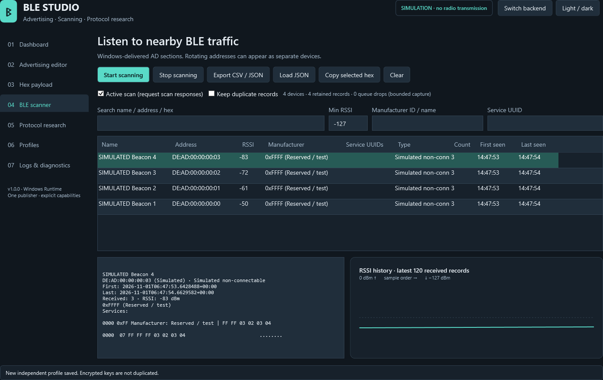
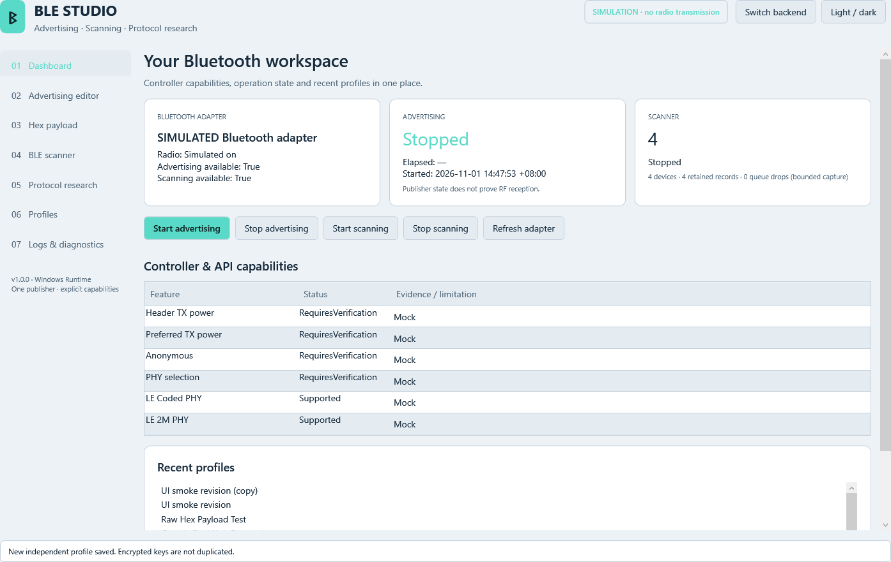

# Windows BLE Advertising Studio

**繁體中文** · [English](README.en.md)

適用於 Windows 10／11 的開源 BLE 廣播、掃描與協定研究工具。使用 C#、
.NET 10 LTS、WPF 與 MVVM 架構開發，採用 MIT 授權。

## Windows 電腦追蹤器候選版：1.1.0-rc.1

新增「追蹤器」頁面、原生 Publisher／GATT 後端、DPAPI 身分與桌面憑證、Google EID 每 1024 秒更新、系統匣與睡眠／喚醒恢復，以及 Docker Compose 自架位置服務。**電腦本身負責藍牙廣播**，保留 Windows 原生驅動；不使用 MCU、韌體燒錄或替換驅動。一次選擇一種協定。

本機實測：Apple 格式完整 31-byte Legacy 要求可到達 Publisher `Started`；完整 Google FHN 的 GATT 要求仍得到 `StartedWithoutAllAdvertisementData`，程式明確判定失敗。Apple 的公開金鑰／實際廣播位址尚未通過比對。**兩條路線均未取得「真實追蹤已驗證」狀態。** API 接受、外部封包驗證、可解密定位回報分開記錄，沒有回報就顯示「尚無定位回報」。

既有 **v1.0.0 Release 維持不變**。候選版 EXE／ZIP、自架部署包與 SHA256 由 `scripts/package-tracking.ps1` 產生於 `artifacts/release-tracker`。參閱 [實測與限制](docs/native-tracking-validation.md)、[繁體中文部署說明](deploy/README.md)及 [English deployment guide](deploy/README.en.md)。獨立 Google Adapter 採 GPL-3.0，其他第三方元件見 [授權聲明](THIRD-PARTY-NOTICES.md)。

追蹤器操作：選擇協定 → 建立／匯入自有私鑰 → 確認所有權與測試者同意 → 啟動。自架服務完成授權後，匯入網頁下載的桌面憑證並註冊身分，再查詢位置。Windows 內顯示最後位置與歷史表格；「地圖與手機介面」開啟同一個 HTTPS 地圖。關閉視窗縮至系統匣，從系統匣退出會停止廣播；休眠與關機期間不會廣播。

## 下載

**[前往 GitHub Releases 下載 Windows 版本](https://github.com/root50643/Windows-BLE-Advertising-Studio/releases)**

一般使用者建議下載 `Windows-BLE-Advertising-Studio-v1.0.0-win-x64.zip`，
完整解壓縮後，開啟 `Windows-BLE-Advertising-Studio-win-x64/BLEStudio.exe`。
不需要安裝 Visual Studio 或額外的 .NET Runtime。

Release 同時提供獨立的 `BLEStudio.exe`、`SHA256SUMS.txt` 與 `build-info.json`。
EXE 為自包含的 Windows x64 單檔程式；ZIP 另包含中英文 README、技術文件、
範例設定檔、畫面截圖與執行階段授權聲明。發布檔目前未經程式碼簽章。

下載後可用 PowerShell 計算雜湊，與同一版本的 `SHA256SUMS.txt` 比對：

```powershell
Get-FileHash .\BLEStudio.exe -Algorithm SHA256
Get-FileHash .\Windows-BLE-Advertising-Studio-v1.0.0-win-x64.zip -Algorithm SHA256
```

## 專案概覽

本工具讓使用者編輯 Windows 與藍牙控制器實際允許的 BLE 廣播內容，並透過
圖形介面操作廣播、掃描、設定檔與封包研究，不需要在一般使用流程中操作命令列。

程式明確區分使用者輸入、送交後端的資料、Publisher 回報的 `Started`，以及
使用者匯入的外部觀測資料。**Windows 接受請求，不代表實際空中封包完全相同，
也不代表已加入 Apple／Google 定位網路或取得定位回報。**

## 實際介面截圖

以下為自動化 GUI 執行時擷取的實際 WPF 畫面，使用有明確標示的模擬後端；
不包含原生視窗外框。實機藍牙測試結果另記錄於[驗證報告](docs/validation-results.md)。






## 功能

- 七個英文 GUI 頁面，支援深色／淺色模式，啟動時不顯示額外主控台視窗。
- 偵測實際藍牙配接器、Radio 狀態，以及可讀取的 PnP／驅動資訊。
- 能力標示為 `Supported`、`Unsupported`、`Unknown` 或 `RequiresVerification`，
  並說明限制與判斷依據。
- Windows BLE 廣播啟停、非同步狀態與錯誤回報，支援 Manufacturer Data、
  非保留的自訂 AD 類型、Extended Advertising、標頭 TX Power、偏好發射功率、
  匿名廣播與依執行環境判斷的 PHY 選項。
- AD 結構建構器可編輯 Manufacturer Data、16／32／128-bit Service Data 與 UUID、
  Solicitation UUID、Flags、Appearance、UTF-8 Local Name 及自訂 AD 類型。
  Windows 保留類型仍可分析與匯出，但會在開始廣播前阻擋。
- 即時 Hex 編輯、Offset／Hex／ASCII 檢視、AD 解析及長度驗證。
- 即時 BLE 掃描、篩選、依位址彙整、裝置詳情及 RSSI 曲線。
- 版本化 JSON 設定檔、修訂歷程、匯入／匯出、複製及重新命名。
- 獨立的 Apple／Google 協定解析、預覽、相容性與外部觀測比對報告。
- 使用 Windows CurrentUser DPAPI 加密研究金鑰，並限制掃描佇列與日誌大小。
- 模擬後端、xUnit 測試、發布 EXE 的 GUI 檢查，以及 Windows GitHub Actions。

README 以繁體中文為主，[英文版](README.en.md)提供相同的使用與限制說明。
**程式介面目前仍為英文**，已提供字串資源架構，方便後續加入繁體中文介面。

## 系統需求

- Windows 10 2004（組建 19041）或更新版本，或 Windows 11；x64。
- 實際廣播／掃描需要可用的 BLE 配接器與 Windows 驅動，且 Bluetooth Radio 已開啟。
  廣播時會檢查配接器的 Peripheral Role 能力。
- Extended Advertising、PHY 等功能取決於實際作業系統、API、控制器與驅動；
  不會僅依裝置型號推定支援。
- 沒有藍牙時，仍可使用編輯、研究、設定檔與模擬模式。

## 快速開始

1. 開啟 `BLEStudio.exe`，在 **Dashboard** 檢查配接器與 Radio 狀態。
2. 在 **Profiles** 選擇 **Generic BLE Beacon**。此範例使用保留／測試用 Company ID
   `0xFFFF` 與小型測試資料，不含定位身分。
3. 前往 **Advertising editor** 修改支援的資料，並確認驗證訊息。
4. 按 **Start advertising**，等待 `Started`；按 **Stop advertising** 停止。
   Windows 也可能回報 `Waiting` 或 `Aborted`，程式會顯示原因。
5. 在 **BLE scanner** 按 **Start scanning**，選擇裝置以查看 AD 結構與 RSSI 歷程，
   完成後按 **Stop scanning**。

**Switch backend** 會先停止現有操作，再切換 Windows BLE 與有明確標示的模擬後端。
模擬成功只代表軟體流程通過，不代表有無線電傳輸。

## BLE 廣播

Windows 後端使用 `BluetoothLEAdvertisementPublisher`。建構器會自動計算 AD 長度、
Company ID 前綴與 UUID 位元組順序；Raw Hex 是送出請求的主要輸入，程式不會悄悄
移除不支援的欄位，再宣稱已送出原始內容。

Windows Publisher 保留多種 AD 類型，包括 Local Name、Flags、TX Power AD、
Service UUID 清單、Service Data、Solicitation 與 Appearance。Manufacturer Data
可提交；非保留的自訂資料仍須通過執行時驗證。公開 Publisher API 不提供廣播間隔、
Connectable／Scannable 旗標、MAC 選擇、位址輪替或 Scan Response 編輯器。
詳見[能力矩陣](docs/windows-capabilities.md)與
[Microsoft Publisher 文件](https://learn.microsoft.com/en-us/uwp/api/windows.devices.bluetooth.advertisement.bluetoothleadvertisementpublisher)。

Legacy 模式以 **28 bytes** 作保守預算提示，包含 AD 長度與類型欄位；**29–31 bytes 允許受控測試並顯示警告**，超過 31 才拒絕。Windows 可能另外加入 Flags，須以外部封包確認內容。Extended 模式使用配接器回報的上限，
Windows 仍可能拒絕特定組合。Duration 是應用程式計時後請求 Stop，無法保證控制器的
實際廣播間隔。偏好發射功率也只是請求，不代表已量測到相同的 RF 功率。

## BLE 掃描器

`BluetoothLEAdvertisementWatcher` 提供 Windows 接收的 AD 結構、名稱、位址類型、
RSSI 與時間戳。可搜尋名稱／位址／Hex、設定最低 RSSI，以及依 Company ID／名稱
或 Service UUID 篩選。主動／被動掃描模式須在開始前選定。

每次接收都會更新計數與裝置摘要。未保留重複封包時，只有資料變更的記錄會進入
擷取歷程。上限為 5,000 個裝置、20,000 筆保留記錄、5,000 筆待處理封包、
每個裝置 120 筆 RSSI 樣本及 2,000 筆日誌；佇列丟棄數會顯示於介面。
藍牙位址可能輪替，因此位址不等於永久裝置身分。

JSON 可儲存並重新載入保留記錄，CSV 則匯出目前裝置摘要。重新載入的計數只反映
保留下來的記錄，無法重建先前捨棄的重複封包。CSV 會處理未受信任名稱的試算表
公式風險；掃描內容仍可能具識別性，請只匯出取得授權的資料。

## Hex Payload 編輯器

支援連續 Hex、空白、換行、`0x` 前綴、逗號、冒號及連字號。非法字元、半個位元組、
截斷的 AD 結構，以及零長度結束符之後的非零資料，都會顯示格式錯誤。
可匯入 `.bin`、純 Hex `.hex`／`.txt`，並匯出 `.bin`／`.hex`。
不支援含位址與校驗記錄的 Intel HEX 檔案格式。

Hex 頁面分別顯示輸入、後端提交、`Started` 確認與外部觀測。可依
[外部觀測 JSON 範例](docs/external-observation.example.json)匯入獨立掃描工具取得的資料，
進行逐位元組比對。觀測來源由使用者提供，程式不會自動認證擷取資料的真實性。

## Apple Find My 研究

解析器辨識 OpenHaystack 的 `0x004C / 0x12 / 0x19` 離線尋找 Manufacturer 格式，
顯示 State、公開金鑰後段、高位元與 Hint。匯入已獲授權的 **28-byte 測試公開金鑰**，
可預覽 AD 結構與所需的 Static Random Address。長度正確不代表已驗證橢圓曲線點
或所有權；其他 AirTag 廣播變體也未獲此解析器認證。

Windows 無法設定協定所需、由金鑰導出的 BLE 位址。候選版允許完整 31-byte 的受控 API 測試，並新增自架 Apple 報告 Provider；但位址不匹配仍會阻止網路相容性，不能宣稱完整 AirTag 配件成功。帳號登入由使用者在私有服務端完成。
參考：[OpenHaystack](https://github.com/seemoo-lab/openhaystack)。

## Google Find Hub 研究

FHN v1.3 解析器辨識 `0xFEAA` Service Data、`0x40`／`0x41` Frame Type、
20／32-byte EID 與 Hashed Flags 欄位。保護模式必須包含 Hashed Flags；一般模式
在符合規格條件時可省略。可使用已授權、事先計算的 EID 建立格式預覽。
**32-byte 機密 EIK** 可另外匯入加密金鑰庫，不會當成 EID 填入廣播內容。

候選版追蹤器頁實作 secp160r1 EIK→EID 推導，並接上自架服務的自有帳號註冊與報告查詢；研究頁仍可獨立預覽事先計算的 EID。Publisher 保留必要的 Flags／Service Data，因此新增 GATT `ServiceData` 後端測試；資料不足不算成功。Fast Pair 配件認證、DULT、響鈴與位址同步尚未完成；不保證出現在官方 Find Hub App。
參考：[Google FHN 規格](https://developers.google.com/nearby/fast-pair/specifications/extensions/fmdn)、
[GoogleFindMyTools](https://github.com/leonboe1/GoogleFindMyTools)。

Apple／Google 的設定檔與金鑰參照彼此獨立。切換設定檔前須停止目前的單一 Publisher；
不保證或宣稱單一控制器能同時進行雙協定廣播。

## 設定檔

首次啟動會將六個內建範本寫入 `%LOCALAPPDATA%/BLEStudio/profiles`。
GUI 支援新增、儲存、重新命名、另存／複製、刪除、匯入及匯出。
儲存會保留前一個修訂版本；可載入舊修訂，再儲存為新的修訂。
切換設定檔會取代尚未儲存的編輯內容。

JSON 頁面可檢視與編輯所有預期參數，包括會在開始廣播前被阻擋的不支援請求。
未知 Schema、欄位及列舉值會明確拒絕，不會默默忽略。
匯出不包含金鑰參照；匯入使用新 ID，不會取得其他本機設定檔的金鑰權限。
複製會建立獨立設定檔，不複製金鑰。

刪除設定檔會保留修訂目錄及另行管理的金鑰；若需要清除金鑰，請先刪除該設定檔
的金鑰，再刪除設定檔。詳見[安全與隱私說明](SECURITY.md)。

## 從原始碼建置

安裝 [.NET 10 SDK](https://dotnet.microsoft.com/download/dotnet/10.0)。
Windows SDK .NET 投影套件由 NuGet 還原，核心功能不依賴付費程式庫。

```powershell
.\scripts\build.ps1
```

此腳本依序還原、編譯、測試、發布及打包，將 EXE 版本、檔案大小與 SHA256
寫入 `build-info.json` 與 `SHA256SUMS.txt`。也支援安裝於
`%USERPROFILE%/.dotnet` 的使用者 SDK。
若原本的發布 EXE 正在執行，可加上 `-OutputDirectory artifacts\release-next`
改用另一個輸出目錄；輸出位置須位於此工作目錄的 `artifacts` 下。

直接發布命令：

```powershell
dotnet publish .\src\BLEStudio.App\BLEStudio.App.csproj -c Release -r win-x64 --self-contained true -p:PublishSingleFile=true -p:PublishTrimmed=false
```

執行測試：

```powershell
dotnet test .\BLEStudio.sln -c Release
.\scripts\test-ui.ps1
.\scripts\test-hardware.ps1   # 選用：會短暫廣播一般測試資料
```

輸出位置：

```text
artifacts/release/
├── BLEStudio.exe
├── Windows-BLE-Advertising-Studio-win-x64/BLEStudio.exe
├── Windows-BLE-Advertising-Studio-v1.0.0-win-x64.zip
├── SHA256SUMS.txt
└── build-info.json
```

EXE 為自包含單檔 WinExe，已停用裁剪；原生執行階段檔案可能解壓到使用者暫存
快取。請保留完整發布套件中的其他檔案。另見[架構](docs/architecture.md)、
[測試](docs/testing.md)與[貢獻指南](CONTRIBUTING.md)。

## GitHub Releases 與 CI/CD

儲存庫：[root50643/Windows-BLE-Advertising-Studio](https://github.com/root50643/Windows-BLE-Advertising-Studio)。
Windows GitHub Actions 會在分支 Push／Pull Request 時建置、測試並上傳發布成品。
推送 `vX.Y.Z` Tag 會執行完整建置及發布 EXE 的模擬 GUI 檢查，再建立 GitHub Release，
附上 **EXE、ZIP、SHA256 清單、建置資訊與 Release Notes**。
CI 使用模擬後端，不需要實體藍牙硬體。
各次實際執行結果請見[Actions](https://github.com/root50643/Windows-BLE-Advertising-Studio/actions)，
發布作業說明見[文件](docs/releasing.md)。

## 已知限制

- Windows 控制 RF 排程、位址、多種 AD 類型與 Scan Response。
- PHY 選項須通過執行時 API、SDK 與控制器能力檢查；偏好功率只是請求。
- 本機 Watcher 不能獨立證明自己 Publisher 的實際空中封包。
- Company 名稱表只涵蓋部分已知 ID；其他 ID 保持數值顯示。
- 未提供 HCI Raw Injection、GATT Server、遠端帳號、裝置註冊、Apple／Google
  定位回報、EID 產生或完整 DULT 配件功能。
- 未提供自動 EID／金鑰／位址輪替，不保證雙協定同時廣播。
- 截圖使用模擬資料；實機結果另記錄，不能由模擬成功推定硬體成功。
- 發布 EXE 尚未進行程式碼簽章。

## 疑難排解

- **沒有配接器／Radio 關閉**：在 Windows 設定開啟藍牙，檢查裝置管理員，
  再按 Refresh adapter。編輯與模擬模式仍可使用。
- **Waiting／Aborted**：停止操作、查看錯誤碼、關閉其他競爭藍牙資源的程式，
  並確認驅動；`DataTooLarge` 也可能與 Windows 廣播政策有關。
- **驗證失敗**：檢查保留 AD 類型與長度。改用其他 AD Type 並不會保留原協定相容性。
- **沒有掃描資料**：等待 Windows 從 Created 轉為 Started，確認 RSSI／搜尋篩選、
  附近 BLE 訊號及相關權限。
- **權限或政策錯誤**：請使用正常的 Windows 藍牙、隱私與組織政策設定處理；
  程式不繞過系統限制。指定發射功率在部分環境會回報 `0x80070005`。
- **啟動或套件問題**：使用完整 ZIP、確認使用者暫存目錄可寫入，並從 Logs & Diagnostics
  匯出診斷。報告可能含本機配接器識別碼，公開前請先檢視。

## 安全與隱私

請使用自有或已獲授權的設備，並確保測試者知情同意。研究操作需要介面中的同意
勾選，研究廣播限制為 1～300 秒。金鑰使用 CurrentUser DPAPI 加密，與設定檔分開，
不會加入一般日誌或預設匯出。DPAPI 無法防護同一 Windows 使用者下的其他程式；
原始匯入的金鑰檔案仍由使用者自行保護。

公開金鑰、EID、掃描匯出仍可能識別測試，請勿任意公開。
詳見[安全政策](SECURITY.md)。

## 授權

[MIT](LICENSE)。相依元件與參考專案說明見[第三方聲明](THIRD-PARTY-NOTICES.md)。
本專案與 Apple、Google、Microsoft 或 Bluetooth SIG 無關，未取得其背書或配件認證。
